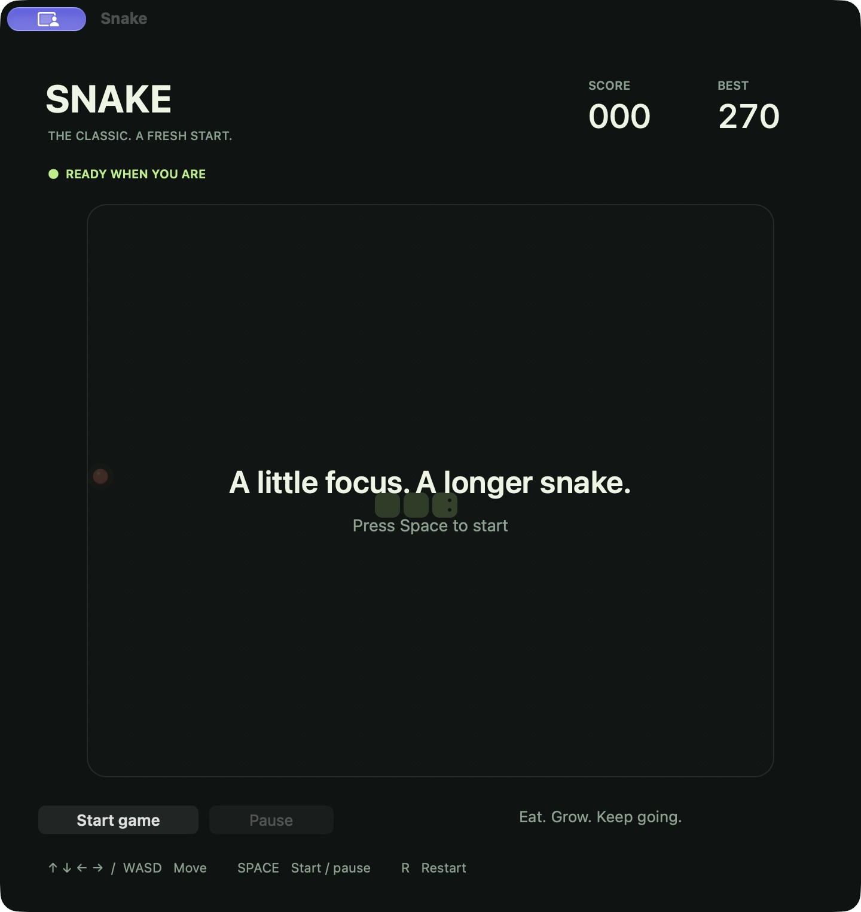
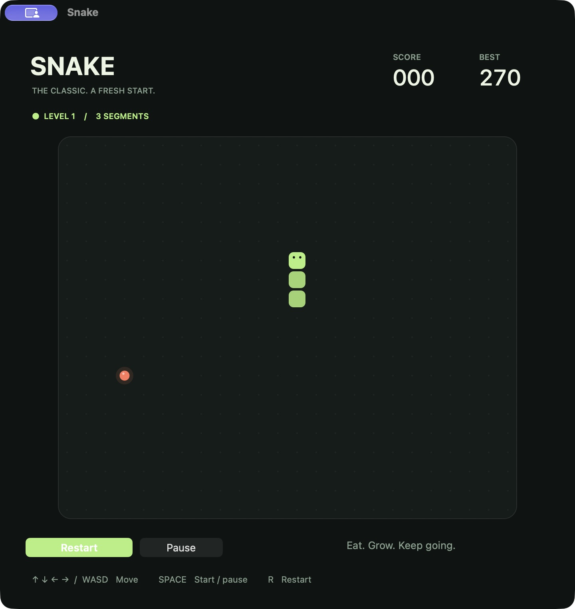

# Snake

A standalone native macOS game built with Swift and AppKit. No browser, server,
third-party packages, or network connection required.

## Screenshots

| Ready to play | In the game |
| --- | --- |
|  |  |

## Run

Build the app using the instructions below, then double-click **Snake.app** in
the project folder. You can also drag it into Applications.
The universal app supports Apple Silicon and Intel on macOS 13 or later.
It is locally ad-hoc signed; public distribution would require Developer ID
signing and notarization.

## Play

| Control | Action |
| --- | --- |
| Arrow keys / WASD | Turn |
| Space / Return | Start, pause, resume, or play again |
| P / Escape | Pause or resume |
| R / Command-N | Restart |
| Command-P | Pause or resume |
| Command-Q | Quit |

Eat coral food for 10 points and one extra segment. Each food makes movement
faster, down to a minimum interval of 65 ms. Walls and your body end the round.
Direct reversals are blocked. Two turns can be buffered, with one applied per
tick. Filling the board wins the game.

The game pauses when its window loses focus. Resume when ready. The best score
is saved after each food using UserDefaults under `com.local.snake` and survives
restarts and app rebuilds.

## Build with command-line tools

Install Apple's Xcode Command Line Tools if needed (`xcode-select --install`).
From this project folder:

```sh
bash scripts/build.sh
```

This compiles both architectures, creates `Snake.app` at the project root, and
ad-hoc signs it. To build for a single architecture:

```sh
ARCHS=arm64 bash scripts/build.sh
# Or, on an Intel Mac:
ARCHS=x86_64 bash scripts/build.sh
```

The current Apple Silicon command-line toolchain emits an Intel compatibility
archive warning, but links the Intel executable successfully. Both architectures
are included; runtime testing was performed on Apple Silicon.

## Build with Xcode

Open `Snake.xcodeproj`, select the **Snake** scheme and **My Mac**, then press
Command-R. To locate the app, right-click Snake.app under Products and choose
Show in Finder.

With full Xcode selected, the equivalent terminal build is:

```sh
xcodebuild -project Snake.xcodeproj -scheme Snake -configuration Release \
  -derivedDataPath build/xcode CODE_SIGN_IDENTITY=- CODE_SIGNING_REQUIRED=NO build
```

The result is `build/xcode/Build/Products/Release/Snake.app`. The project and plist
were syntax-validated here; the Xcode build requires full Xcode, which is not
installed in this environment. The supplied app was compiled with `swiftc`.

## Validation

```sh
bash scripts/test.sh
codesign --verify --deep --strict --verbose=2 Snake.app
```

The deterministic game tests cover movement, reverse prevention, buffered input,
food placement, growth, scoring, increasing speed, all walls, self-collision,
moving into a vacated tail cell, pause/resume, restart, full-board victory, and
UserDefaults persistence. Tests use an isolated preferences suite.

Native UI checks cover launch, keyboard start/pause/resume, arrow and WASD input,
restart, normal quit/relaunch, and retained high score. The window was visually
inspected for layout. Intel execution and full Xcode builds were not tested.
No gameplay crashes were observed. The macOS log reports system-service warnings
from App Intents (`linkd.autoShortcut`) and BaseBoard in this environment; these
did not prevent launch or gameplay. Secure state restoration is explicitly enabled.

## Project structure

- `Sources/Game.swift` — grid model, movement, collisions, food, high-score store.
- `Sources/BoardView.swift` — native board drawing and keyboard input.
- `Sources/AppDelegate.swift` — window, menus, controls, timer, lifecycle.
- `Sources/main.swift` — application entry point.
- `Resources/` — application metadata and custom icon.
- `Tests/main.swift` — standalone game-logic tests.
- `scripts/` — build, test, and icon-generation tools.
- `Snake.xcodeproj/` — native Xcode project.
- `docs/screenshots/` — screenshots of the running macOS app.

To regenerate the vector-drawn icon:

```sh
mkdir -p build/module-cache
xcrun swift -module-cache-path build/module-cache scripts/make-icon.swift build/Snake.iconset
bash scripts/build.sh
```
